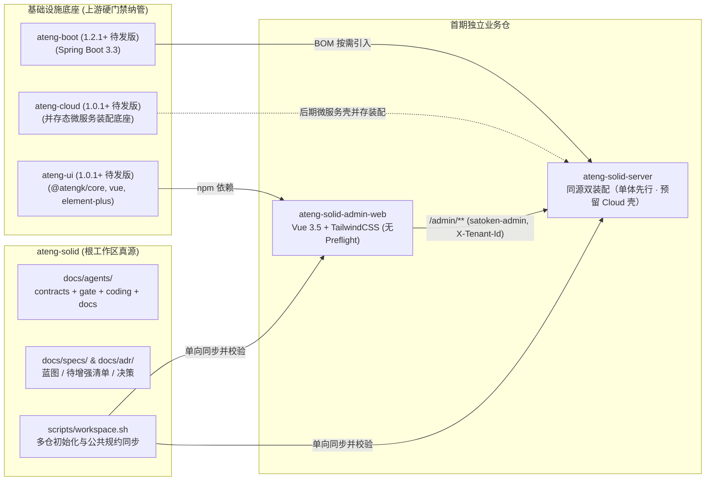

# Context Map: ateng-solid

**ateng-solid** 是兼具“**底座实战试金石**”与“**可直接二开的企业级开源上层框架**”双定位的多端聚合工作区（Polyrepo Workspace），由根仓库统筹跨端通信契约与系统级蓝图，各端作为独立 Git 仓库并行演进并保持运行时解耦。

---

## Contexts (工作区与子工程边界)

- **[Root 根工作区](./AGENTS.md)**（`ateng-solid`）：
  聚合工作区总控中心。维护全端跨端契约唯一真源（[`docs/agents/contracts.md`](./docs/agents/contracts.md)）、底层缺口即停工与联调 SOP（[`docs/agents/foundation-first-gate.md`](./docs/agents/foundation-first-gate.md)）、编码与注释规范（[`docs/agents/coding-standards.md`](./docs/agents/coding-standards.md)）、文档 1:1 保真规范（[`docs/agents/documentation-specification.md`](./docs/agents/documentation-specification.md)）、系统级 ADR（[`docs/adr/`](./docs/adr/README.md)）、首期架构蓝图与底层待增强清单（[`docs/specs/`](./docs/specs/README.md)）及统一运维脚本 [`scripts/workspace.sh`](./scripts/workspace.sh)。
- **[Server 后端核心服务](./ateng-solid-server/CONTEXT-MAP.md)**（`atengk/ateng-solid-server`，首期落地）：
  Spring Boot 3.3 + `ateng-boot`（1.2.0+）**同源双装配**后端工程：首期稳固 `common` ➔ `system-api` ➔ `{system, auth}` ➔ `bootstrap` 5 模块单体，面向后续 `ateng-cloud`（`1.0.0+`）并存微服务启动壳保留零重构扩展边界，对外以对称路径 `/admin/**` 暴露管理端契约。
- **[Admin Web PC 管理后台](./ateng-solid-admin-web/CONTEXT.md)**（`atengk/ateng-solid-admin-web`，首期落地）：
  Vue 3.5 + Vite + TypeScript Strict + `@atengk/core`/`@atengk/vue`/`@atengk/element-plus` + TailwindCSS（禁用 Preflight）单页后台应用，手写强类型 `src/api/*` 契约层直接对齐后端。
- **远期多端扩展工程（规划中）**：
  `ateng-solid-mp`（小程序）、`ateng-solid-app`（跨平台 App）、`ateng-solid-desktop`（PC 桌面端）、`ateng-solid-portal-web`（门户官网），各端严格通过各自终端路由前缀（`/app/**`、`/portal/**`、`/open/**`）与独立 `loginType` 接入后端，前端各端之间零代码共享。

---

## Relationships (协同与依赖拓扑)

### 核心约束律
1. **单向规约真源律**：`contracts.md` 与 `foundation-first-gate.md` 只允许在根仓库修订，由 `workspace.sh sync-rules` 单向分发，根仓 CI 与本地脚本负责阻止子仓漂移。
2. **底层缺口即停工与双向独立律**：发现 `ateng-boot`、`ateng-cloud`、`ateng-ui` 缺失能力或缺陷时，立即暂停受阻上层特性开发（绝不打临时补丁），待底座通过通用改造（严禁写死本项目约定）并发版后再恢复上层开发。
3. **三层二开扩展界限律**：纯技术基础设施沉底座；通用管理域内核留 `ateng-solid`；具体行业二开业务（`biz-*`）按独立域扩展挂载，不篡改或侵入框架内核（`auth`/`system`）。
4. **终端物理隔离律**：每个前端仓库只消费对应前缀的后端端点与独立 `loginType` 会话体系（管理端独占 `/admin/**` + `satoken-admin`），后端无论是单体还是经过 `ateng-cloud-gateway`，前端仅需消费同一份 `/admin/**` 契约。
5. **无共享前端包律**：不同终端仓库之间不抽取私有共享 UI/业务源码包，通用能力一律下沉至 `ateng-ui` 或由各仓消费统一后端 API 契约。

---

## Architectural Decisions

跨端及工作区级架构决策索引维护于 **[架构决策记录看板 (docs/adr/README.md)](./docs/adr/README.md)**。
