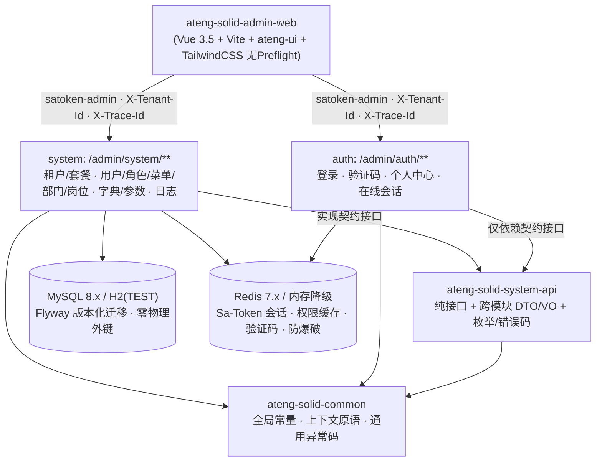

# 首期 MVP 架构与领域蓝图 (Blueprint)

- **规划版本**：v1.0.0
- **创建时间**：2026-11-18
- **关联规范**：[跨端契约](../../.agents/rules/contracts.md) | [底层增强清单](./foundation-enhancements-checklist.md)

---

## 1. 业务目标与首期 MVP 边界

构建基于 `ateng-boot`、`ateng-cloud` 与 `ateng-ui` 的企业级多租户统一后台底座，完成认证会话、SaaS 多租户、组织架构、RBAC + 数据权限、数据字典与系统审计监控的首期闭环；同时遵循**“同源双装配（单体先行稳固 + 预留 `ateng-cloud` 微服务并存扩展壳）”**架构策略，从 Day 1 锁定纯接口边界与数据库/事件解耦，支持未来在不重写核心业务的前提下与微服务架构双态并存。

### 1.1 首期纳入范围 — 最小稳定内核 (Core Kernel · In Scope)
1. **认证与会话域 (`auth`)**：管理端登录（`/admin/auth/**`、`loginType="admin"`、`satoken-admin`）、可开关图形验证码（`CaptchaTemplate`）、登录防爆破锁定（`LoginFailureLockService`）、个人信息与密码修改（`PasswordUtil` PBKDF2）、在线会话查看与强退（内核预留 `AuthGrantHandler` 认证策略 SPI 支撑扩展）。
2. **多租户基础（可开关、默认关闭，`system`）**：支持通过 `ateng.solid.tenant.enabled`（**默认 `false`**，联动 `ateng.boot.mybatis-plus.tenant.enabled`）启停多租户隔离；底层保留完整行级多租户（`tenant_id BIGINT NOT NULL DEFAULT 0`，默认平台租户 `0` / 编码 `000000`）、租户套餐（`sys_tenant_package`）及平台超管切换租户能力，关闭时首期按极简单租户开箱运行，开启后零重构激活 SaaS 多租户。
3. **组织与 RBAC (`system`)**：用户管理（含基础导入/导出对接 `ateng-boot-excel` 与头像上传对接 `ateng-boot-storage`）、角色管理（含 5 级 `@DataScope` 数据权限）、菜单权限树（`M`/`C`/`F`）、部门树与岗位管理。
4. **字典、枚举与参数 (`system`)**：静态 `IBaseEnum` 枚举端点（`/admin/system/enums`）、动态数据字典（`sys_dict_type`/`sys_dict_data`）与系统参数（`sys_config`）。
5. **审计与可观测 (`system` / `bootstrap`)**：登录日志（`sys_login_log`）、操作审计日志（`sys_oper_log`，对接 `@OperateLog` + `OperateLogStorageProvider` SPI）与基础健康探针（`ateng-boot-observability`）；前端预留开关式 `@atengk/monitor` 接入。

### 1.2 明确延后至二期 — 装配期可插拔扩展模块 (Pluggable Extensions · Out of Scope for MVP)
遵循 [ADR-0005](../adr/0005-kernel-plus-pluggable-extensions.md)，二期特性与行业业务不混写进内核源码，按独立扩展模块（`ext-*` / `biz-*`）装配插拔，**首期暂不提前建空壳**：
- 第三方 OAuth2 / 社会化登录（`ext-social`，消费 `ateng-boot-social` + `AuthGrantHandler` SPI）
- 站内信与 WebSocket/SSE 实时推送（`ext-realtime`，消费 `ateng-boot-realtime`）
- 分布式定时任务调度控制台（`ext-job`，消费 `ateng-boot-job-local`/`xxl`/`snail`）
- 动态多数据源物理分库（`ext-datasource`，消费 `ateng-boot-datasource`）
- 业务流/低代码表单/大屏图表（`ateng-ui` L2 重型扩展包，前端 `src/modules/*` 按需自发现装配）与多语言 `vue-i18n`

---

## 2. 系统架构拓扑与表域归属

### 数据表按服务域物理归属（为 Cloud 拆服零外键解耦铺路）

| 服务域 | 核心表名 | 继承实体基类 | 租户隔离 |
| :--- | :--- | :--- | :---: |
| **系统域（平台共享）** | `sys_tenant`、`sys_tenant_package`、`sys_tenant_package_menu`、`sys_menu`、`sys_dict_type`、`sys_dict_data` | `BaseDeleteIdEntity`（关联表轻量实体） | 否（`ignore-tables`） |
| **系统域（租户隔离）** | `sys_dept`、`sys_post`、`sys_role`、`sys_user`、`sys_config`、`sys_user_role`、`sys_user_post`、`sys_role_menu`、`sys_role_dept` | `BaseDeleteIdEntity`（关联表轻量实体） | 是（`tenant_id BIGINT NOT NULL DEFAULT 0`） |
| **系统域（审计流水）** | `sys_oper_log`、`sys_login_log` | `BaseIdEntity`（无软删与乐观锁） | 是（`tenant_id BIGINT NOT NULL DEFAULT 0`） |
| **认证域 (`auth`)** | 原则上**不自建持久层业务表**；会话/验证码/防爆破存储于 Redis，登录日志通过领域事件交由 `system` 落库 | - | - |

---

## 3. 演进拆分路线（Spec 规划）

正式开始编码前，将按以下顺序分步推进并落实测试先行闭环（首期单体 MVP 统一收敛为 **`Spec 0 ~ Spec 4`**，后续 `ateng-cloud` 同源双态挂壳独立归口为 **`Spec 5`**）：
1. **Spec 0（底层硬门禁前置）**：按 [底层缺口即停工规范](../../.agents/rules/foundation-first-gate.md) 与 [底层基础设施待增强清单](./foundation-enhancements-checklist.md) 解决 `ateng-boot`（`#1076~#1080`、`#1093` 及 `ateng-boot-flyway` 发版）与 `ateng-ui`（`#362~#365` 发版）已识别底座缺口并锁定递进正式 Release 版本（`ateng-boot:1.2.1+` / `ateng-ui:1.0.1+`）。
2. **Spec 1（工程骨架、公共原语与扩展 SPI 定义）**：完善 `ateng-solid-server` 5 模块 POM/ArchUnit/Flyway 双模配置、公共常量/错误码/`DomainEventPublisher` 与内核 SPI 端口（如 `AuthGrantHandler` 接口定义），与 `ateng-solid-admin-web` Vite/Tailwind/ateng-ui 基座。
3. **Spec 2（认证会话闭环）**：图形验证码与多租户开关透传、账密 PBKDF2 登录、防爆破、超管启动引导初始化、`getInfo`/动态路由与在线会话管理。
4. **Spec 3（RBAC、数据权限与可开关多租户）**：菜单/角色/部门/岗位/用户管理、`@DataScope` 5 级数据权限、前端动态路由权限闭环，以及开关式 `sys_tenant`/`sys_tenant_package` 租户治理与套餐联动裁剪。
5. **Spec 4（字典、参数、文件与审计）**：枚举字典、`sys_dict`、`sys_config`、头像上传与用户 Excel 原子校验批注回写导入导出、`sys_oper_log`/`sys_login_log`。
6. **Spec 5（后续演进：`ateng-cloud` 同源双态并存挂壳）**：待 `ateng-cloud`（`#198~#205`）就绪且单体稳固后，同仓并列挂载 `cloud-gateway` / `cloud-auth` / `cloud-system` 启动壳复用同一份核心业务模块。
