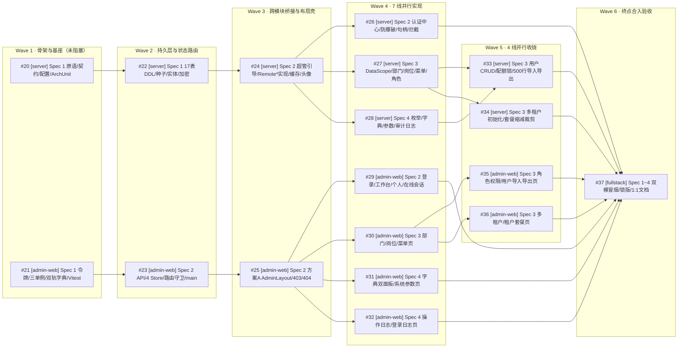

# 第一阶段（`Spec 1 ~ Spec 4`）编码开工准入检查表与 1:1 终审报告

- **关联路线图**：
  - PRD 与原型阶段：[第一阶段（MVP 内核）需求文档（PRD）与高保真交互原型路线图](https://github.com/atengk/ateng-solid/issues/1)（收口工单：[第一阶段 PRD 与技术 Specs / 术语表 1:1 终审与签收归档](https://github.com/atengk/ateng-solid/issues/10)）
  - 工程架构与工单拆解阶段：[第一阶段（Spec 1 ~ Spec 4）工程架构设计与编码工单拆解路线图](https://github.com/atengk/ateng-solid/issues/11)（收口工单：[整合 Spec 1 ~ Spec 4 工程终稿、同步 issue-tracker 规范并在根仓拆解 ready-for-agent 编码工单](https://github.com/atengk/ateng-solid/issues/19)）
- **终审范围**：
  - 根仓真源：`docs/agents/{contracts,foundation-first-gate,coding-standards,documentation-specification,issue-tracker}.md`、`docs/specs/mvp-architecture-and-domain-blueprint.md`、`docs/specs/foundation-enhancements-checklist.md`、`docs/specs/prd/{design-system,00..04}.md`、`docs/specs/_research/*`、`docs/prototypes/phase1/*`、`docs/adr/0001~0006`
  - 后端仓：`ateng-solid-server/AGENTS.md`、`ateng-solid-server/docs/specs/*`（含 `system-engines-and-testing-spec.md`）、`ateng-solid-server/docs/adr/0001~0004`、`ateng-solid-server/*/CONTEXT.md`、`ateng-solid-server/docs/agents/issue-tracker.md`
  - 前端仓：`ateng-solid-admin-web/AGENTS.md`、`ateng-solid-admin-web/docs/specs/*`、`ateng-solid-admin-web/docs/adr/0001~0003`、`ateng-solid-admin-web/CONTEXT.md`、`ateng-solid-admin-web/docs/agents/{styling-and-ateng-ui,issue-tracker}.md`

---

## 1. 跨端 1:1 一致性终审结论

经逐项比对，`docs/agents/contracts.md`（响应信封 `Result<T>`、6 位分段错误码 `100xxx`/`101xxx`/`102xxx`、雪花 `string` 主键、`tenant_id BIGINT NOT NULL DEFAULT 0`、`super_admin`、`satoken-admin`、`X-Tenant-Id`、`X-Trace-Id`、三段式权限码、Fesod 批注回执）与第一阶段 PRD（`00~04`）保持 **100% 协议一致**，无需修改跨端契约。

在本次 `#10` 终审中，已将 PRD 阶段调研与决策确立的以下增量与纠偏 **1:1 同步回写至前后端子仓 Specs、Rules 与 ADR**：

| 目标文档 | 同步修正核心内容 |
| :--- | :--- |
| `ateng-solid-server/docs/specs/database-and-flyway-spec.md` | 补齐 `sys_user.pwd_update_time`、`sys_menu.platform_only`、`sys_role.{menu_check_strictly, dept_check_strictly, remark}`、`sys_tenant_package.{menu_check_strictly, remark}`、`sys_{tenant,post,user,dict_type,dict_data,config}.remark`、`sys_oper_log.{browser, os}`（`operate_type INT`）；注明 `F5`（`DefaultMetaObjectHandler` 不填 `deleted`/`version`，须 DDL `DEFAULT 0`）；增补第一阶段种子数据完整初始化核对表 |
| `ateng-solid-server/docs/specs/api-and-error-codes-spec.md` | 新增 `GET /admin/auth/profile`、`POST /admin/auth/profile/avatar`；在线强退改用不透明句柄 `DELETE /admin/auth/online/{sessionId}`（`tokenMask` 防泄漏）；移除冗余 `/admin/system/user/avatar`；补齐 `user/options`、`user/import/template`、`tenant/options`、`tenant-package/{id,status,shrink-preview}`、`dict/{type,data}/...`、`config/{id}` 及全量 `PUT /{id}/status` 端点与 `100001`/`100004`/`100005` 错误码 |
| `ateng-solid-server/docs/specs/auth-rbac-and-datascope-spec.md` | 纠偏 `CaptchaTemplate.verify`（`101001`）、`LoginFailureLockService.isLocked` + `getDisableTime`（`101004`）、4 步登录校验链、3 参 `PermissionCacheService`、显式收敛 `super-admin-roles: ["super_admin"]`、`@OperateLog(type = ...)` 与 `OperateLogModel.{userAgent, browser, os}`、`DataScopeType` 归属及改密/重置/停删全端踢出 |
| `ateng-solid-server/docs/specs/configuration-and-archunit-spec.md` | 补充 `super-admin-roles`、`tenant.allow-super-admin-switch`、`storage.guard` 等配置基线及 `B14`/`B15` 增量门禁标注 |
| `ateng-solid-server/ateng-solid-auth/CONTEXT.md` | 补充 `不透明会话句柄 (Opaque Session Handle)` 术语，并明确防爆破锁定覆盖 IP 熔断维度 |
| `ateng-solid-admin-web/docs/specs/views-and-routes-spec.md` | 对齐定稿 **方案 A + `Precision Slate & Cobalt`**、`AdminLayout` 尺寸与 `U5` 约束、`/dashboard` 初始口令提醒、`/profile` 独立读写与头像上传、`/403` 零菜单退出兜底、`/system/online` 不透明会话句柄及 `/system/dict` 同屏双面板 |
| `ateng-solid-admin-web/docs/specs/frontend-architecture-and-conventions.md` | 对齐 `src/styles/` 自定义 `Precision Slate & Cobalt` 令牌入口、`src/api/` 映射与 `/403`/`/404` 自适应布局 |
| `ateng-solid-admin-web/docs/agents/styling-and-ateng-ui.md` & `docs/adr/0001-*` | 正式修订为“脱离 `theme-pro.css` 默认靛紫皮肤、以 `Precision Slate & Cobalt` 自有令牌覆写或独立挂载（保留 TailwindCSS v4 无 Preflight 与 `@atengk/element-plus/style.css`）”；更新 `ateng-ui#365` 为已就绪状态，补充 `AtengCaptcha` `:refresh`、`AtengQueryForm` 防双重重置、`DictManager` `'default'` 归一化与 `U5~U8` 编码提示 |

---

## 2. 底座缺口再审计结论（`ateng-boot` / `ateng-ui`）

经核对 `docs/specs/prd/_research/boot-1.2.0-constraints.md`、`ui-1.1.0-capabilities.md` 与上游仓库最新 `dev` 提交及 GitHub Issues 状态：**本次终审未发现新的未登记底座缺口**；且先前登记的 **6 项增量门禁均已在上游 `dev` 修复验收并关闭 Issue**（尚未发布 Maven Central / npm 正式版，已按 `docs/agents/foundation-first-gate.md` 第 4 节 SOP 切入本地联调态供先行开发验证，**正式提交合入 `dev`/`main` 前须待发版并还原正式锁版**）：

| 门禁编号 | 上游 Issue & `dev` 提交 | 当前状态 | 本地联调方式 | 正式合入红线 |
| :---: | :--- | :---: | :--- | :--- |
| **B14** | [`atengk/ateng-boot#1171`](https://github.com/atengk/ateng-boot/issues/1171) (`8e7bef82`) | `CLOSED`（待发版） | `ateng-boot:1.2.1-SNAPSHOT` | `pre-commit` 拦截 `-SNAPSHOT` 提交；正式合入前锁版 `1.2.1+` |
| **B15** | [`atengk/ateng-boot#1172`](https://github.com/atengk/ateng-boot/issues/1172) (`0c172a12`) | `CLOSED`（待发版） | `ateng-boot:1.2.1-SNAPSHOT`（新增 `whitelist-presigned-download: true` 与 `upload-endpoint-enabled: false`） | `pre-commit` 拦截 `-SNAPSHOT` 提交；正式合入前锁版 `1.2.1+` |
| **B16 / B17** | [`atengk/ateng-boot#1173`](https://github.com/atengk/ateng-boot/issues/1173) / [`#1174`](https://github.com/atengk/ateng-boot/issues/1174) | `CLOSED`（待发版） | `ateng-boot:1.2.1-SNAPSHOT`（新增 `data-permission.failure-strategy: DENY_ALL` 与 Fesod 按次 `maxSyncRows` 重载） | 同上 |
| **U5 ~ U8** | [`atengk/ateng-ui#369`](https://github.com/atengk/ateng-ui/issues/369) ~ [`#372`](https://github.com/atengk/ateng-ui/issues/372) (`36da58c`) | `CLOSED`（待发版） | `pnpm pack + yalc` 接入 `@atengk/element-plus` | `pre-commit` 拦截 `file:.yalc` 提交；发版后执行 `yalc remove --all && pnpm up @atengk/*` |
| **U9 ~ U12** | [`atengk/ateng-ui#373`](https://github.com/atengk/ateng-ui/issues/373) ~ [`#376`](https://github.com/atengk/ateng-ui/issues/376) | `CLOSED`（待发版） | `pnpm pack + yalc` 接入 `@atengk/element-plus`（`.vue.d.ts` + `GlobalComponents`、`style.css` 内置 loading/theme-switch、`AtengQueryForm`/`AtengDictTag`/`AtengExcelFeedback` 修复、`AtengTabsNav` `emitCloseOnBatch`/`@batch-close`/`menuIcons`/`iconResolver`） | 同上 |

---

## 3. 第一阶段种子数据完整初始化核对表（`V1.0.1__system_init_seed.sql`）

> 对应路线图 `#1` `Not yet specified` 收口项：迁移 SQL 仅写入非敏感元数据；平台超管用户（`super_admin`）及初始 PBKDF2 口令由 `ateng-solid-system` 的 `SuperAdminBootstrapper` 动态落库（单体与微服务同源共享），**严禁在 SQL 脚本中硬编码密码哈希**。

### 3.1 基础元数据种子（`V1.0.1__system_init_seed.sql`）

| 表名 | 确定性种子记录 | 关键字段与业务约束 |
| :--- | :--- | :--- |
| **`sys_tenant`** | `id = 0`（平台默认租户） | `tenant_code = '000000'`、`tenant_name = '平台默认租户'`、`package_id = NULL`、`account_count = -1`、`expire_time = NULL`、`status = 0`、`deleted = 0` |
| **`sys_dept`** | `id = 100`（平台默认顶级部门，号段 `100 ~ 999`） | `tenant_id = 0`、`parent_id = 0`、`ancestors = '0'`、`dept_name = '平台总部'`、`phone = NULL`、`email = NULL`、`sort = 1`、`status = 0`、`deleted = 0` |
| **`sys_role`** | `id = 1`（平台内置超管角色，号段 `1 ~ 99`） | `tenant_id = 0`、`role_name = '超级管理员'`、`role_key = 'super_admin'`、`data_scope = 1` (`ALL`)、`menu_check_strictly = 1`、`dept_check_strictly = 0`、`sort = 1`、`status = 0`、`deleted = 0`（不预插 `sys_role_menu`） |
| **`sys_dict_type`** | `10001` / `10002`（号段 `10001 ~ 10999`） | ① `10001` `sys_user_gender`（`用户性别`、`status = 0`）；② `10002` `sys_yes_no`（`系统是否`、`status = 0`） |
| **`sys_dict_data`** | `11001~11003` / `11101~11102`（号段 `11001 ~ 19999`） | `sys_user_gender`：`0=男 (primary)`、`1=女 (warning)`、`2=未知 (info, is_default=1)`；`sys_yes_no`：`Y=是 (primary)`、`N=否 (info, is_default=1)` |
| **`sys_config`** | `20001`（号段 `20001 ~ 29999`） | `tenant_id = 0`、`config_name = '用户管理-初始默认密码'`、`config_key = 'sys.user.initPassword'`、`config_value = 'Ateng@2026'`、`config_type = 'Y'`、`deleted = 0` |

### 3.2 初始菜单与按钮权限树（`sys_menu` · 号段 `1000 ~ 9999` · 共 4 个 `M` 目录 + 12 个 `C` 菜单 + 42 个 `F` 按钮 = 58 条）

> `/dashboard`（工作台）与 `/profile`（个人中心）为前端静态路由，不强制写入动态菜单表（或由 `/dashboard` 作为静态固定页签兜底）。平台专属标记 `platform_only = 1` 的菜单及下属全部 `F` 按钮，严禁入选任何租户套餐。

| 域目录 (`M`) | 菜单页面 (`C` · 路径 / 组件 / 路由名) | `platform_only` | `keep_alive` | 归属 `F` 按钮权限标识 (`perms`) |
| :--- | :--- | :---: | :---: | :--- |
| **组织权限** (`/system`, `platform_only=0`) | 用户管理 (`/system/user`, `system/user/index`, `SysUser`) | `0` | `1` | `system:user:{list,create,update,delete,import,export}` |
| 同上 | 角色管理 (`/system/role`, `system/role/index`, `SysRole`) | `0` | `1` | `system:role:{list,create,update,delete}` |
| 同上 | 菜单管理 (`/system/menu`, `system/menu/index`, `SysMenu`) | **`1`** | `1` | `system:menu:{list,create,update,delete}` |
| 同上 | 部门管理 (`/system/dept`, `system/dept/index`, `SysDept`) | `0` | `1` | `system:dept:{list,create,update,delete}` |
| 同上 | 岗位管理 (`/system/post`, `system/post/index`, `SysPost`) | `0` | `1` | `system:post:{list,create,update,delete}` |
| **基础配置** (`/config`, `platform_only=0`) | 数据字典 (`/system/dict`, `system/dict/index`, `SysDict`) | **`1`** | `1` | `system:dict:{list,create,update,delete}` |
| 同上 | 系统参数 (`/system/config`, `system/config/index`, `SysConfig`) | `0` | `1` | `system:config:{list,create,update,delete}` |
| **多租户治理** (`/tenant`, **`platform_only=1`**) | 租户管理 (`/system/tenant`, `system/tenant/index`, `SysTenant`) | **`1`** | `1` | `system:tenant:{list,create,update,delete}` |
| 同上 | 租户套餐 (`/system/tenant-package`, `system/tenant-package/index`, `SysTenantPackage`) | **`1`** | `1` | `system:tenant-package:{list,create,update,delete}` |
| **审计安全** (`/audit`, `platform_only=0`) | 操作日志 (`/system/oper-log`, `system/oper-log/index`, `SysOperLog`) | `0` | `0` | `system:oper-log:list` |
| 同上 | 登录日志 (`/system/login-log`, `system/login-log/index`, `SysLoginLog`) | `0` | `0` | `system:login-log:list` |
| 同上 | 在线会话 (`/system/online`, `system/online/index`, `OnlineSession`) | `0` | `0` | `auth:online:{list,kickout}` |

### 3.3 启动引导器初始化（`SuperAdminBootstrapper`）
- 归属 `ateng-solid-system`（`ApplicationRunner`），仅当平台默认租户（`tenant_id = 0`）下不存在任何绑定 `super_admin` 角色（`role_id = 1`）的有效用户时触发（可选 Redis `SETNX` 30s 短锁 + `uk_user_tenant_username_deleted` 捕获 `DuplicateKeyException` 事务外复查双防线）：
  - 创建默认超级管理员账号（读取 `ateng.solid.init.super-admin-username`，默认 `superadmin`，归属 `dept_id = 100`、`pwd_update_time = NULL`、`phone = NULL`、`email = NULL`）；
  - 口令来源与日志分流：若外部显式配置 `ateng.solid.init.super-admin-password`，须通过 `PasswordPolicyValidator` 校验且日志**严禁打印任何口令字符**；若未配置则自动生成 16 位必含 4 类字符且剔除 `0/O/o/1/I/l` 的一次性强随机口令，并仅在该首次创建时于独立 `WARN` Banner 中**明文输出一次**提醒登录后立即修改与清理日志；`application-test.yml` 配置测试桩口令 `Ateng@Test2026`；
  - 绑定 `sys_user_role`（`tenant_id = 0`、`role_id = 1`）。

---

## 4. `Spec 1 ~ Spec 4` 编码开工准入检查表

### Spec 1：工程骨架、公共原语、配置基线与前端设计令牌
- [ ] **高危配置前置收敛（必改）**：在 `ateng-solid-bootstrap/src/main/resources/application.yml` 显式配置 `ateng.boot.satoken.super-admin-roles: ["super_admin"]`（覆盖底座默认 `["admin", "super_admin"]`）与 `spring.servlet.multipart.max-file-size: 5MB` / `max-request-size: 10MB`（防默认 `1MB` 提前 413 截断 `2MB` 上传）；
- [ ] 在 `application.yml` 补全 `permission-cache.tenant-scoped: true`、`tenant.{allow-super-admin-switch, platform-tenant-ids}`、`data-permission.failure-strategy: DENY_ALL`（`#1173`）、`async.pools.password-hash`（`mode: platform`）、默认 S3 兼容对象存储（`storage.type: s3` + `s3.path-style: true` + `guard` 与 `local` 回退安全配置）及 3 个按域内聚的 `@ConfigurationProperties`（`SolidTenantProperties`/`SolidAuthProperties`/`SolidSystemProperties`），并在 `bootstrap/pom.xml` 补齐 `flyway-mysql` 与 `software.amazon.awssdk:{s3,apache-client}`（`runtime`）；
- [ ] 模块原语归属落地：`ateng-solid-common` 落地 `CommonBizResultCode`、`CommonStatusEnum`、`LogStatusEnum`、`PasswordPolicyValidator`、`DomainEventPublisher`/`SpringDomainEventPublisher`/`LoginAuditEvent` 与 `AuthGrantHandler` SPI；`ateng-solid-system-api` 落地 `SystemResultCode`、`DataScopeType`、`MenuTypeEnum`、`ConfigTypeEnum`、`VisibleStatusEnum` 及 4 个 `Remote*Service`（15 方法）；`ateng-solid-auth` 落地 `AuthResultCode`；`SuperAdminBootstrapper` 归属 `ateng-solid-system`；
- [ ] `ateng-solid-bootstrap` 将 `ArchitectureGuardTest` 升级为 9 条 ArchUnit 硬守卫（离线 `mvn clean test` 通过）；
- [ ] `ateng-solid-admin-web` 彻底移除 `theme-pro.css`，按 6 段导入序落地 `src/styles/tokens.css`（Light `#1D4ED8` / Dark `#3B82F6` 静态色阶映射至 `--el-*` 与 Tailwind v4 `@theme`，禁用 Preflight，`initTheme` 不传 `themeColor` + `index.html` 防 FOUC）；落地 `src/utils/{http,dict,icon}.ts`（三单例 + 全错误码分流 + `lowerCamelCase`/`snake_case` 双轨 `DictManager`）与 `tests/setup.ts` 离线隔离基线，且 `main.ts` 在 `app.use(router)` 前完成 `createAtengVue` 全量挂载。

### Spec 2：认证会话、工作台、个人中心、在线会话与布局壳
- [ ] 登录链路严格执行“图形验证码（`CaptchaTemplate.verify` ➔ `101001`）➔ 租户解析（`101005`）➔ 防爆破锁定（先查 `isIpLocked`/`getIpLockTime`，再查 `isLocked`/`getDisableTime`，抛出 `LoginLockedException` 经 `GlobalExceptionCustomizer` 在 `Result.data` 返回 `LoginLockDetailVO { lockType, remainSeconds }`）➔ 账密防枚举统一计数（`101002`/`101003`/`101004`）”；
- [ ] 登录接口返回 `AdminLoginVO`（含 `tenantId`/`tenantName`）；`/admin/auth/captcha` 返回 `expireSeconds`；`/admin/auth/info` 返回 `passwordNeedsChange`（由 `pwd_update_time IS NULL` 计算）；`AuthService` 无事务包装，成败与登出均发布 `LoginAuditEvent`；
- [ ] 个人中心拆出 `GET /admin/auth/profile`、`PUT /admin/auth/profile` 与 `POST /admin/auth/profile/avatar`；修改密码 `PUT /admin/auth/password` 成功后写入 `pwd_update_time` 并全端下线；
- [ ] 在线会话 `/admin/auth/online/page` 仅下发 `tokenMask`（前 6 后 4 + `****`）与无状态 `AES-256-GCM + AAD` 签密句柄 `sessionId`（`OpaqueSessionHandleCodec`），强退 `DELETE /admin/auth/online/{sessionId}` 损坏/跨租户报 `400`、自身会话报 `101007`、已过期幂等返 `200`；
- [ ] 多租户开启时激活 `TenantAvailabilityInterceptor`（`order = 10`）+ `TenantAuthDTO` 零漂移缓存（60s Redis + 读时比对实时时间 + 写后驱逐）：普通租户停用/过期自动 `logout` 并抛 `101005`，超管切换失效租户由 `TenantHeaderSwitchValidator` 抛 `100002`（不注销 `"0"` 会话）；
- [ ] 前端落地定稿 **方案 A 轻量自建 `AdminLayout`**（`AdminSidebar` `228px/60px` + `AdminHeader` `48px` + `AtengTabsNav` `36px` [`:emit-close-on-batch="false"` + `@batch-close` + `:menu-icons`] + `TenantObserveBanner` `36px` + `<KeepAlive>` + `provide(ATENG_PRO_LAYOUT_KEY)`）与 4 个 Pinia Setup Store（`useAuthStore` 共享 `useAuth` `WeakMap` 零漂移）；
- [ ] `/login`（`AtengCaptcha` `:refresh` Prop、`101004` `err.cause.data` `IP`/`ACCOUNT` 倒计时、CapsLock 提示、`redirect` 白名单）、`/dashboard`、`/profile`（`AtengUpload` `:http-request` 桥接）、`/403`（零菜单退出兜底）、`/404` 通过 `pnpm 四合一` 与 Vitest 三层离线单测。

### Spec 3：组织架构、RBAC、`@DataScope` 与可开关 SaaS 多租户
- [ ] **增量底座联调与正式合入锁版检查**：
  - `B14`（`#1171`）、`B16`（`#1173`）、`B17`（`#1174`）与 `U6~U8`（`#370~#372`）、`U9~U12`（`#373~#376`）均已在底座 `dev` 关单，本地已分别通过 `1.2.1-SNAPSHOT` 与 `yalc` 接入可直接开展开发与自测；**正式向 `dev`/`main` 提交合入前**须待底座发布递进正式版并还原锁版；
- [ ] Flyway `V1.0.0__system_init_schema.sql`（17 表全量 `utf8mb4_0900_ai_ci` + 表简名前缀索引 + 显式 `NOT NULL DEFAULT 0` + 加密列宽 `phone 128`/`email 255`）与 `V1.0.1__system_init_seed.sql`（`< 100,000` 确定性 ID 号段、58 条菜单含 42 `F` 按钮）通过 MySQL 8.4 LTS 与 H2 (`MODE=MySQL`) 双模校验；`SysUser`/`SysDept` 联系字段经 `ContactFieldCrypto` 收口确定性加密与归一化；
- [ ] 实现 `SolidDataPermissionHandler` SPI（内部查询包 `runWithoutPermission`、`DEPT_AND_CHILD` 预解析 `sys_dept.ancestors` 禁写 `FIND_IN_SET` + `1000` 部门上限抛 `100003`、无部门兜底 `1 = 0`、`sys_user` `userColumn = "id"`）与 `TenantHeaderSwitchValidator` SPI；
- [ ] 角色/用户/菜单/租户权限缓存与会话强退副作用一律经 `TransactionUtil.executeAfterCommit` 后置触发（3 参 `PermissionCacheService.clearUserCache`/`clearRoleCache` 与 `clearAll`）；角色菜单回显遵循“联动态仅传叶子 ID”；
- [ ] 租户套餐严格过滤 `platform_only = 1`、实现 `shrink-preview` 与原子裁剪 `sys_role_menu`；新建租户事务外预哈希后执行 4 步原子初始化；配额并发校验采用 `PessimisticLockUtil.forUpdate` 行锁；停用/删除租户提交后分页清退全员会话；
- [ ] 用户导入实现 9 列模板下载（`import/template`）、单次 `byte[]` 双读 + `#1174` 按次 `maxSyncRows=500` 重载、三段式解耦流水线（无事务校验 ➔ `Semaphore(2)` + 平台池 `password-hash` 并行哈希 ➔ 短事务批插，前端超时 `120s`）、剥离 `ExcelErrorRow.rowData` 及 Redis 双 Key 15 分钟归属隔离批注下载（`import/feedback/{feedbackToken}`）。

### Spec 4：静态枚举、动态字典、系统参数、头像直链与只读审计日志
- [ ] **增量底座联调与正式合入锁版检查**：默认走 `storage.type=s3`（RustFS/MinIO，需 `software.amazon.awssdk:{s3,apache-client}`）+ `guard.enabled=true` + `strict-magic-check=true`；本地磁盘回退模式保留 `B15`（`#1172`）`local.whitelist-presigned-download=true` + `upload-endpoint-enabled=false` + 固定 `secret-key`；**正式提交合入前**须待 `ateng-boot` 发布正式版并还原锁版；
- [ ] `SysEnumController` 接管 `/admin/system/enums/**` 并配置 `@SaCheckLogin`；前端枚举适配层将 `OptionItem` 映射为 `DictItem` 并把 `'default'` 归一化为 `''`；
- [ ] `/system/dict` 平台专属双面板管理支持 `dictType` 编辑锁定与 `isDefault` 同类型事务互斥（`30m` 缓存写后驱逐）；`sys_config` 对内置 `Y` 禁止删改键名、`sys.user.initPassword` 强制强口令校验，并支持多租户读取自动回退平台租户 `0` 全局默认值；
- [ ] `@OperateLog` 统一使用 `type = OperateTypeEnum.XXX`；`SolidOperateLogStorageProvider` 在异步线程中基于 `model.tenantId` + `model.userId` 主键查库补全真实 `userName`（禁调 `LoginHelper.getLoginUser()`）并落库 `description`/`browser`/`os`；登录日志消费领域事件并复用 `UserAgentUtil.parse`；两日志模块保持严格只读。

---

## 5. 双模本地联调与全链路冒烟验证规程

> 面向 `application-local.yml`（云端 MySQL 8.4 LTS + Redis 8.x + RustFS S3 Path-Style）与 `.env.local` 的端到端实机联调与合入前冒烟检查步骤（真实凭据严禁入库）。

### 5.1 本地机密配置文件准备（严禁纳入 Git）
1. **后端**（复制 `ateng-solid-server/ateng-solid-bootstrap/src/main/resources/application-local.example.yml` 为同目录 `application-local.yml`）：
   - MySQL 8.4 LTS：配置 JDBC URL（携带 `allowPublicKeyRetrieval=true&serverTimezone=Asia/Shanghai&characterEncoding=utf8`）、账号密码与 `spring.flyway.enabled: true`；
   - Redis 8.x：配置主机、端口、密码与 DB（严禁依赖 `FLUSHALL`/`FLUSHDB`/`CONFIG` 命令）；
   - RustFS / S3 兼容对象存储：`ateng.boot.storage.type: s3`，填入 `endpoint`、`bucket`、`access-key`、`secret-key`（保持 `path-style: true`、`auto-create-bucket: true`）；
   - 固定安全密钥：`ateng.boot.mybatis-plus.crypto.secret-key`（确定性联系字段加密）与 `ateng.solid.auth.session-handle-secret`（不透明会话句柄签密，32+ 字符）。
2. **前端**（复制 `ateng-solid-admin-web/.env.example` 为 `.env.local`）：
   - `VITE_API_BASE_URL=`（保持留空直通 `/admin` 代理），`VITE_PROXY_TARGET=http://127.0.0.1:8080`。

### 5.2 模式 A：单租户默认态冒烟检查（`ateng.solid.tenant.enabled: false`）
1. **启动与初始化**：启动 `SolidApplication` ➔ 确认 Flyway 成功执行 `V1.0.0`（17 表）与 `V1.0.1`（58 条菜单等种子）➔ 确认 `SuperAdminBootstrapper` 在空库首次启动打印一次 16 位强随机口令 `WARN` Banner，重启后幂等跳过且不再打印。
2. **认证、验证码与防爆破**：访问 `/login` ➔ 确认租户编码框隐藏、图形验证码正常加载刷新；连续输错密码达阈值 ➔ 确认返回 `101004` 且前端精确展示倒计时（修改用户名对 `ACCOUNT` 立即清零）；使用正确凭据登录 ➔ 跳转 `/dashboard` 看到顶部改密提醒条 ➔ 前往 `/profile` 完成资料编辑（真明文回显/列表脱敏）、上传 `<=2MB` 头像（确认 RustFS 落桶与 `inline` 预签名直览）并修改密码 ➔ 确认原会话立即强制下线，新口令登录后提醒条消失。
3. **组织、RBAC、`@DataScope` 与 500 行导入**：验证 `/system/dept`（含防自环与子孙 `ancestors` 联改）、`/system/post`、`/system/menu`（`AtengIconSelect`）、`/system/role`（联动态仅叶子回显 + 5 级 `@DataScope` 真 SQL 过滤）；在 `/system/user` 验证完整手机号精确检索、下载 9 列模板、上传含错 Excel 验证整批不入库并下载 15 分钟归属隔离标红批注 `.xlsx`、上传合法批量 Excel 验证并发哈希落库与导出 `@ExcelSensitive` 脱敏。
4. **枚举、字典、参数与只读审计**：核验未登录访问 `/admin/system/enums` 返回 `401`，登录后 7 个静态枚举（含 `operateType`）正常返回；验证 `/system/dict` 双面板与写后缓存刷新、`/system/config` 内置项锁键禁删；核验 `/system/oper-log`（异步真实 `userName`、`browser`/`os`、脱敏 JSON）与 `/system/login-log` 严格只读落库；核验 `/system/online` 仅展示 `tokenMask`、禁强退自身（`101007`）且可强退其他会话。

### 5.3 模式 B：多租户开启态冒烟检查（`ateng.solid.tenant.enabled: true` + `ateng.boot.mybatis-plus.tenant.enabled: true`）
1. **登录与租户隔离**：访问 `/login` 确认租户编码框可见（默认 `000000`）；平台 `super_admin` 登录后可见 `/system/tenant` 与 `/system/tenant-package`。
2. **租户创建与套餐裁剪**：创建仅含非 `platform_only` 菜单的套餐 ➔ 新建测试租户（核验 4 步初始化并记录初始管理员凭据）➔ 缩减套餐菜单确认弹出 `shrink-preview` 受影响租户确认窗并裁剪目标租户 `sys_role_menu`。
3. **跨租户观察态与 `100002` / `101005` 拦截**：
   - 平台超管通过顶栏切换器切入测试租户 ➔ 确认展示 36px 琥珀金全宽通栏警示条、平台专属菜单隐藏、测试租户未配置 `sys.user.initPassword` 时自动兜底读取平台租户 `0` 配置；
   - 另开无痕窗口登录测试租户管理员账号，并在平台视角将测试租户停用或过期 ➔ 确认普通租户接口触发 `TenantAvailabilityInterceptor` 自动注销并返回 `101005` 跳回 `/login`；确认平台超管若仍持有已停用租户视角收到 `100002` 并自动复位回 `"0"` 且**不登出平台会话**。

---

## 6. `Spec 1 ~ Spec 4` 编码实施总导航表与依赖拓扑

> 全部编码工单统一收口于 `atengk/ateng-solid`（标签 `ready-for-agent` + 原生 `blockedBy` 依赖链），源码仍按独立子仓开发提交。未阻塞起始波次为 **Wave 1**（前后端可立即并行启动）。

### 6.1 依赖拓扑总览（6 波次 DAG）

### 6.2 18 张 `ready-for-agent` 编码工单明细表

| 波次 | 阶段 | 归属仓 | 编码工单（点击直达） | 原生 `blockedBy` |
| :---: | :---: | :---: | :--- | :--- |
| **Wave 1** | `Spec 1` | `server` | [[server] Spec 1: 落地后端 5 模块公共原语、system-api 纯接口契约、双模配置基线与 9 条 ArchUnit 守卫](https://github.com/atengk/ateng-solid/issues/20) | 无（可直接认领） |
| **Wave 1** | `Spec 1` | `admin-web` | [[admin-web] Spec 1: 落地 Precision Slate & Cobalt 令牌、无 Preflight 样式入口、三单例 HTTP/双轨字典/图标工具与 Vitest 隔离基线](https://github.com/atengk/ateng-solid/issues/21) | 无（可直接认领） |
| **Wave 2** | `Spec 1` | `server` | [[server] Spec 1: 落地全库 17 表 Flyway DDL（V1.0.0）、确定性种子（V1.0.1）、17 实体/Mapper 与 ContactFieldCrypto](https://github.com/atengk/ateng-solid/issues/22) | 依赖 `#20` |
| **Wave 2** | `Spec 2` | `admin-web` | [[admin-web] Spec 2: 落地认证 API、4 个 Pinia Setup Store、动态路由守卫与 main.ts 8 步启动装配](https://github.com/atengk/ateng-solid/issues/23) | 依赖 `#21` |
| **Wave 3** | `Spec 2` | `server` | [[server] Spec 2: 实现 SuperAdminBootstrapper、Remote*Service 核心契约实现、TenantAuthDTO 零漂移缓存与 AvatarUrlResolver](https://github.com/atengk/ateng-solid/issues/24) | 依赖 `#22` |
| **Wave 3** | `Spec 2` | `admin-web` | [[admin-web] Spec 2: 实现方案 A 轻量 AdminLayout 布局壳（Sidebar/Header/TabsNav/ObserveBanner/KeepAlive）与 403/404 异常页](https://github.com/atengk/ateng-solid/issues/25) | 依赖 `#23` |
| **Wave 4** | `Spec 2` | `server` | [[server] Spec 2: 实现管理端认证中心（/admin/auth/**）、防爆破 101004 透传、不透明会话句柄与租户运行时拦截](https://github.com/atengk/ateng-solid/issues/26) | 依赖 `#24` |
| **Wave 4** | `Spec 3` | `server` | [[server] Spec 3: 实现 SolidDataPermissionHandler（5 级 @DataScope）、组织架构（部门/岗位）与权限树（菜单/角色）后端闭环](https://github.com/atengk/ateng-solid/issues/27) | 依赖 `#24` |
| **Wave 4** | `Spec 4` | `server` | [[server] Spec 4: 实现静态枚举自主接管（/admin/system/enums）、动态字典、系统参数（多租户兜底缓存）与操作/登录只读审计日志](https://github.com/atengk/ateng-solid/issues/28) | 依赖 `#24` |
| **Wave 4** | `Spec 2` | `admin-web` | [[admin-web] Spec 2: 实现管理端登录页（/login）、轻量工作台（/dashboard）、个人中心（/profile）与在线会话页（/system/online）](https://github.com/atengk/ateng-solid/issues/29) | 依赖 `#25` |
| **Wave 4** | `Spec 3` | `admin-web` | [[admin-web] Spec 3: 实现组织架构与基础 RBAC 页面（部门树 /system/dept、岗位 /system/post、菜单树 /system/menu）](https://github.com/atengk/ateng-solid/issues/30) | 依赖 `#25` |
| **Wave 4** | `Spec 4` | `admin-web` | [[admin-web] Spec 4: 实现动态字典双面板（/system/dict）与系统参数管理（/system/config）](https://github.com/atengk/ateng-solid/issues/31) | 依赖 `#25` |
| **Wave 4** | `Spec 4` | `admin-web` | [[admin-web] Spec 4: 实现只读操作审计日志（/system/oper-log）与登录审计日志（/system/login-log）](https://github.com/atengk/ateng-solid/issues/32) | 依赖 `#25` |
| **Wave 5** | `Spec 3` | `server` | [[server] Spec 3: 实现用户管理 CRUD、配额并发防超卖与 500 行 Fesod Excel 三段式并发导入导出/批注暂存](https://github.com/atengk/ateng-solid/issues/33) | 依赖 `#27`, `#28` |
| **Wave 5** | `Spec 3` | `server` | [[server] Spec 3: 实现可开关 SaaS 租户管理（4 步原子初始化）与租户套餐（platform_only 校验、shrink-preview 与跨租户裁剪）](https://github.com/atengk/ateng-solid/issues/34) | 依赖 `#27` |
| **Wave 5** | `Spec 3` | `admin-web` | [[admin-web] Spec 3: 实现角色权限（/system/role）与用户管理（/system/user 含左部门树、精准手机检索与 Fesod 导入导出批注）](https://github.com/atengk/ateng-solid/issues/35) | 依赖 `#30` |
| **Wave 5** | `Spec 3` | `admin-web` | [[admin-web] Spec 3: 实现多租户管理（/system/tenant）与租户套餐管理（/system/tenant-package 含缩减裁剪预览）](https://github.com/atengk/ateng-solid/issues/36) | 依赖 `#30` |
| **Wave 6** | `Spec 1~4` | `fullstack` | [[fullstack] Spec 1~4: 执行双模云端实机联调冒烟、全仓 1:1 文档逆向沉淀与底座正式版锁版合入验收](https://github.com/atengk/ateng-solid/issues/37) | 依赖 `#26`, `#29`, `#31`, `#32`, `#33`, `#34`, `#35`, `#36` |
